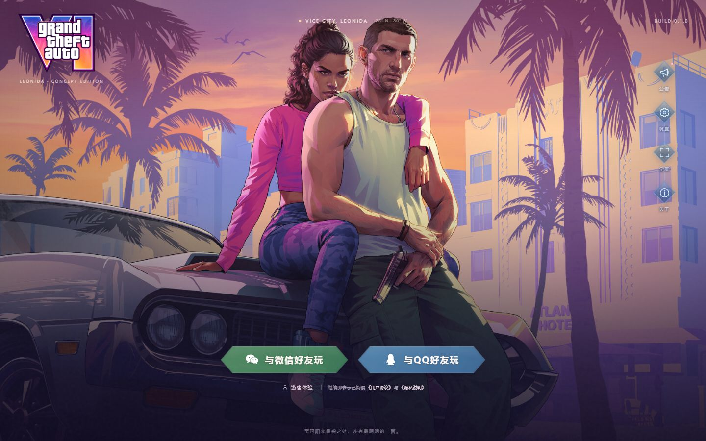
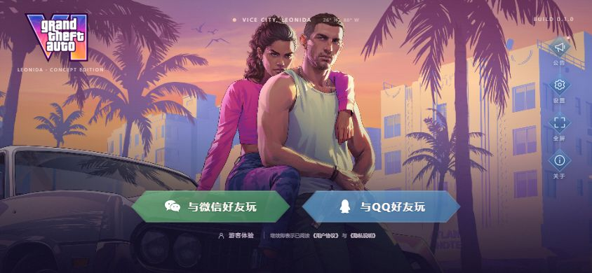
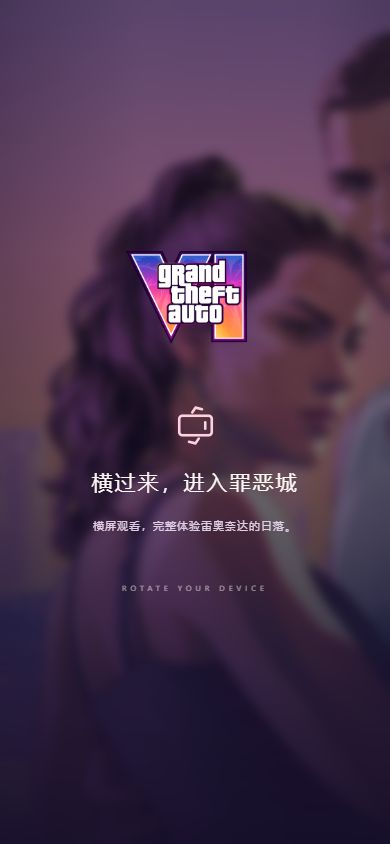

# GTA VI 概念登录页

> **非官方粉丝概念页。** 本项目为个人学习与前端练习作品，与 Rockstar Games、Take-Two Interactive 无任何关联，未获其授权或认可。
>
> 页面中使用的 GTA VI 美术图、名称与标志版权归 Rockstar Games 所有（出处见 [assets/SOURCES.md](assets/SOURCES.md)），仅作为个人非商业演示引用，不随本仓库的 MIT 许可证授权。若权利人提出要求，将立即移除相关素材。 
> 项目不包含任何游戏运行能力，不是官方 GTA VI 手机游戏，也不提供真实登录、账号或支付功能。

参考横屏手游登录布局的纯前端娱乐演示，使用 GTA VI 官方美术素材。无需后端、安装依赖或真实登录。

## 打开

- 直接使用现代浏览器打开 `index.html`。
- 或在项目目录运行 `npm run dev`，打开 <http://127.0.0.1:5173>。只需要 Node.js，无需 `npm install`。
- `npm run check` 检查 JavaScript 语法。

## 在线访问

- GitHub Pages：<https://USERNAME.github.io/REPO/>
- 临时分享（本机需先 `npm run dev`）：`cloudflared tunnel --url http://127.0.0.1:5173`

## 预览截图

| 桌面 | 手机横屏 | 手机竖屏提示 |
| --- | --- | --- |
|  |  |  |

## 功能

- 四张本地官方壁纸，每 6 秒切换，1.2 秒交叉淡化，画面缓慢放大至 105%。
- 点击“设置”中的缩略图切换背景；可暂停轮播、关闭镜头运动。主画面隐藏图片序号、名称和轮播指示条。
- 公告、协议、隐私说明、关于弹窗，以及三个模拟登录入口。
- 登录区参考手游启动界面：“与微信好友玩”“与QQ好友玩”使用并排半透明六边形主按钮，游客体验与协议放在下方；右侧工具为菱形徽章与竖向细线。桌面页脚使用 GTA VI 官网主题文案。
- 模拟登录只展示约 1 秒连接动画和欢迎弹窗，不请求真实服务、不索取凭据。
- 手机横屏、桌面全屏布局，竖屏提供旋转提示，兼容安全区域。
- 页面隐藏时暂停背景；系统开启减少动态效果时不执行缩放和淡化。
- 图片不可用时自动跳过，全部不可用时显示渐变兜底，页面交互仍有效。
- 全屏功能依赖浏览器支持；部分 iOS 浏览器不支持页面全屏，此时会给出提示。

本页不接入追踪、Cookie、持久化存储或第三方脚本。运行时所有素材都从本地读取。初版无背景音乐。

## 结构与后续扩展

- `index.html`：页面结构及内联矢量图标。
- `styles.css`：布局、动画、适配及减少动态效果支持。
- `app.js`：`BackgroundController` 管理背景，其他函数管理弹窗和模拟登录。
- `assets/images/`：官方美术图和独立标志。
- `assets/SOURCES.md`：素材的准确官方来源。
- `preview/`：验收截图与记录，供 README 引用。
- `server.cjs`：可选的本地静态预览服务，仅监听本机地址。

背景信息集中在 `app.js` 的 `scenes` 数组，每张图单独配置裁切焦点。后续接入视频时仅替换 `BackgroundController` 的加载和呈现逻辑，并保留 `start`、`show`、`setPaused`、`setMotion` 等界面调用，不需要重新编写登录区域。

所有页面设置仅保存在内存中。刷新页面恢复默认设置。此项目不是官方 GTA VI 手机游戏，也不包含游戏运行能力。

## 许可证

代码以 [MIT](LICENSE) 许可证开源，可自由使用、修改和再分发。

`assets/images/` 下的美术素材与 GTA VI 名称、标志版权归 Rockstar Games 所有，**不包含在 MIT 授权范围内**，请勿将其用于任何商业用途或再分发。
